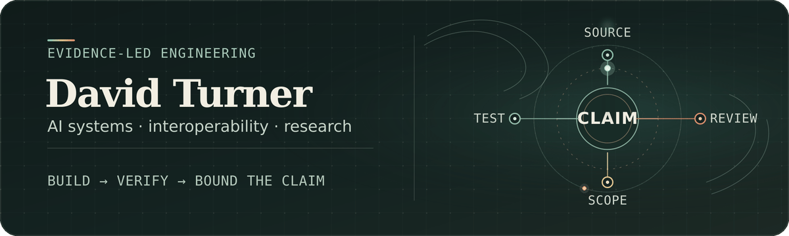
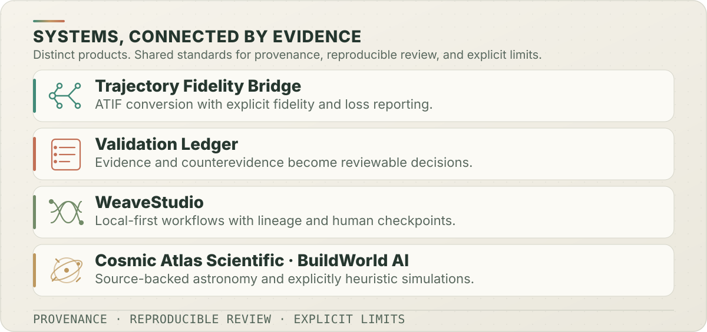
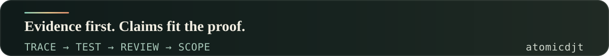

<!-- Historical profile snapshot; contribution status and links may have changed since November 2026. -->

# David Turner

I build and harden AI-assisted software with a focus on reliability, evidence, and clear failure handling. My background also includes asset protection and loss prevention.

**External contribution record (verified November 5, 2026): 16 authored pull requests merged in external repositories** — 10 Rosetta, 3 Super Productivity, 1 OpenClaw, and 2 OpenWorldRPGUnreal. The [source-linked record](writing/external-validation-upstream-review.md) includes the [newly merged Super Productivity #11273](https://github.com/super-productivity/super-productivity/pull/11273). This count includes only PRs authored by me and marked merged; unmerged proposals and comments on PRs by others are excluded.

- **[Rosetta #320](https://github.com/griddynamics/rosetta/pull/320):** made a safety check for destructive Git commands faster, with independent reviewer testing.
- **[OpenClaw #187880](https://github.com/openclaw/openclaw/pull/187880):** fixed a scheduling rule that could leave new work waiting.
- **[Trajectory Fidelity Bridge](https://github.com/atomicdjt/trajectory-fidelity-bridge):** converts supported coding-agent histories into a portable trajectory format and reports known information loss.
- **[CrewAI Stripe Recovery Fixture](https://github.com/atomicdjt/crewai-stripe-recovery-fixture):** demonstrates recovery from ambiguous payment-provider responses using simulated tests.

I use AI tools in development and document what the evidence supports and what remains unverified.

[Portfolio](https://ai-project-portfolio-portfolio-hub.vercel.app/) · [LinkedIn](https://www.linkedin.com/in/david-turner-6052491a2) · [Email](mailto:davidelsey9513@gmail.com)

## Start here: three checks of the work

| What to evaluate | Direct evidence | What it actually establishes |
| --- | --- | --- |
| **Can a change withstand adversarial review?** | [Rosetta #320](https://github.com/griddynamics/rosetta/pull/320) · [Engineering case study](writing/engineering-proof-cases.md#case-1-rosetta-320--a-performance-fix-that-required-a-security-equivalence-argument) | A dangerous-command matcher fix merged after independent differential, scaling, and mutation review; not a general security certification |
| **Can an observation be separated from an inference?** | [AgentMeasure DR-005](https://github.com/roy-tong/AgentMeasure/blob/main/design-rationale/DR-005-evidence-calibrated-consumption-claims.md) · [Attributed fixture](https://github.com/roy-tong/AgentMeasure/blob/main/conformance/evidence/inference-boundary-aggregation-replay/README.md) | An external project explicitly credited my limited reviewer input and synthetic fixture; not authorship of the full specification |
| **Can an ambiguous tool result be handled conservatively?** | [CrewAI Stripe Recovery Fixture](https://github.com/atomicdjt/crewai-stripe-recovery-fixture) · [Boundary case study](writing/engineering-proof-cases.md#case-2-recovery-after-an-ambiguous-tool-side-effect) | Local, fault-injected SQLite/provider-double behavior; not a live Stripe, distributed exactly-once, or upstream CrewAI guarantee |

More projects, contributions, and review routes

The contribution record below is a November 4 snapshot and predates the November 5 merge described in recent work.

**Verified external contribution record (November 4, 2026): 15 authored pull requests merged in four repositories** — **10 Rosetta**, **2 super-productivity**, **1 OpenClaw**, and **2 OpenWorldRPGUnreal**. These are external repositories, not merges into my own projects. [OpenClaw #187880](https://github.com/openclaw/openclaw/pull/187880) fixed an owner-capacity scheduling defect and was accepted by a maintainer. [Rosetta #377](https://github.com/griddynamics/rosetta/pull/377), [#378](https://github.com/griddynamics/rosetta/pull/378), and [#379](https://github.com/griddynamics/rosetta/pull/379) address destructive cleanup prevention, duplicate agent IDs, and parsing timeout exit codes. See the [source-linked external-validation record](writing/external-validation-upstream-review.md); no broader adoption, employment, or commercial endorsement is implied.

## Selected recent work

- **Recent accepted upstream fixes:** [OpenClaw #187880](https://github.com/openclaw/openclaw/pull/187880) merged October 29 after a focused Workboard scheduling change and upstream review ([technical case study](writing/openclaw-workboard-owner-capacity-case-study.md)). [Rosetta #377](https://github.com/griddynamics/rosetta/pull/377), [#378](https://github.com/griddynamics/rosetta/pull/378), and [#379](https://github.com/griddynamics/rosetta/pull/379) also merged October 29. [Super Productivity #11273](https://github.com/super-productivity/super-productivity/pull/11273) merged November 5 ([case study](writing/super-productivity-weekday-api-case-study.md)). **Open at this check:** [Home Assistant frontend #55484](https://github.com/home-assistant/frontend/pull/55484) and [Bitwarden clients #24289](https://github.com/bitwarden/clients/pull/24289). [Rosetta #397](https://github.com/griddynamics/rosetta/pull/397) is a follow-on authored by `xyrolle`, on which I commented; it is not my authored merge.
- **Published article:** [When Research Evidence Stops Surviving Product Decisions](https://medium.com/researchops-community/when-research-evidence-stops-surviving-product-decisions-183579089904?postPublishedType=approve-in-publication) was accepted and published by the ResearchOps Community on Medium on October 22, 2026.
- **External repository merges:** [Rosetta #359](https://github.com/griddynamics/rosetta/pull/359) merged after maintainer review. [OpenWorldRPG #252](https://github.com/TateParker/OpenWorldRPGUnreal/pull/252) and [#253](https://github.com/TateParker/OpenWorldRPGUnreal/pull/253) were merged in a collaborator's repository; #252 reports a UE 5.8.4 build and three focused tests, with its PR documenting remaining limits.
- **CrewAI reliability work:** [Profile-repository PR #40](https://github.com/atomicdjt/atomicdjt/pull/40), [#41](https://github.com/atomicdjt/atomicdjt/pull/41), and [#42](https://github.com/atomicdjt/atomicdjt/pull/42), plus recovery-fixture [#1](https://github.com/atomicdjt/crewai-stripe-recovery-fixture/pull/1) and [#2](https://github.com/atomicdjt/crewai-stripe-recovery-fixture/pull/2), add pinned-runtime dispatch tests, fault injection, SQLite recovery ownership, and evidence-state safeguards. Fixture #1 reports 20/20 deterministic tests passing on its final head. This is mock/local test evidence, not a CrewAI upstream patch, live Stripe validation, or an exactly-once guarantee.
- **Additional merged maintenance and review work:** [Validation Ledger #49](https://github.com/atomicdjt/validation-ledger/pull/49) cleared production DOMPurify advisories; [Trajectory Fidelity Bridge #46](https://github.com/atomicdjt/trajectory-fidelity-bridge/pull/46) removed a stale Ruff suppression; [QuoteForge #33](https://github.com/atomicdjt/quoteforge-local/pull/33) and [#37](https://github.com/atomicdjt/quoteforge-local/pull/37) addressed dependency/type compatibility; and [Cosmic Atlas #9](https://github.com/atomicdjt/cosmic-atlas-scientific/pull/9) added a source-backed reviewer path. Profile and portfolio PRs also refreshed attribution, evidence links, and reviewer navigation.

## Selected systems

| Project | Why it exists | Inspect it |
| --- | --- | --- |
| **[Trajectory Fidelity Bridge](https://github.com/atomicdjt/trajectory-fidelity-bridge)** | Convert supported Claude Code history to ATIF v1.7 with explicit fidelity/loss reporting, not an invented promise of native session resumption | [PyPI 0.4.2](https://pypi.org/project/atomicdjt-trajectory-fidelity-bridge/) · [Verification report](https://github.com/atomicdjt/trajectory-fidelity-bridge/blob/main/docs/VERIFICATION_REPORT.md) |
| **[Validation Ledger](https://github.com/atomicdjt/validation-ledger)** | Trace evidence and counterevidence into reviewable decisions without passing off a heuristic score as truth | [Live demo](https://validation-ledger.vercel.app/) · [Release validation](https://github.com/atomicdjt/validation-ledger/blob/main/docs/VALIDATION.md) |
| **[WeaveStudio](https://github.com/atomicdjt/weavestudio)** | Build, review, and export local-first workflows with source lineage and human checkpoints | [Live demo](https://weavestudio-nine.vercel.app/) · [Release verification](https://github.com/atomicdjt/weavestudio/blob/main/docs/RELEASE_VERIFICATION.md) |
| **[BuildWorld AI](https://github.com/atomicdjt/buildworld-ai)** | Reproducible graph scenarios for cascades, sensitivity, and systems intuition under explicitly heuristic models | [Live simulation](https://buildworld-ai-v01-improvements.vercel.app/) · [Methodology](https://github.com/atomicdjt/buildworld-ai/blob/main/METHODOLOGY.md) |
| **[Cosmic Atlas Scientific](https://github.com/atomicdjt/cosmic-atlas-scientific)** | An offline astronomy atlas connecting source-derived catalog data, explicit provenance, and bounded numerical tools | [v5.1.0 release](https://github.com/atomicdjt/cosmic-atlas-scientific/releases/latest) · [v6 development reviewer guide](https://github.com/atomicdjt/cosmic-atlas-scientific/blob/main/docs/REVIEWER_QUICKSTART.md) |

## How I work

**Specify an invariant → build the smallest implementation → introduce a falsifying test → inspect independent feedback → publish only the claim the evidence supports.**

My current work includes TypeScript/React applications, Python CLIs, agent-tool boundaries, provenance-aware workflows, and browser/local data models. AI tools assist with research, coding, tests, and drafting; I direct requirements and verification, review changes, and take responsibility for published work.

## Independent review routes

- **Engineering and security reviewers:** start with [Rosetta #320 and the recovery case studies](writing/engineering-proof-cases.md), then inspect tests and the upstream discussion.
- **Technical operations and product teams:** use the [five-minute portfolio review](https://ai-project-portfolio-portfolio-hub.vercel.app/review) and try [Validation Ledger](https://validation-ledger.vercel.app/) or [WeaveStudio](https://weavestudio-nine.vercel.app/).
- **Agent interoperability reviewers:** inspect [Trajectory Fidelity Bridge](https://github.com/atomicdjt/trajectory-fidelity-bridge) and its [compatibility limits](https://github.com/atomicdjt/trajectory-fidelity-bridge/blob/main/docs/COMPATIBILITY.md).
- **Contribution and publication attribution:** use the [current-work index](docs/CURRENT_WORK.md) and [source-by-source correction register](https://github.com/atomicdjt/AI-Project-Portfolio/blob/main/docs/discovery/external-corroboration.md). This distinguishes authored merges from submitted, unverified, rejected, and incorrectly attributed work.

**Technical writing:** [ResearchOps Community article](https://medium.com/researchops-community/when-research-evidence-stops-surviving-product-decisions-183579089904?postPublishedType=approve-in-publication) · [Upstream verification](writing/external-validation-upstream-review.md) · [Tool history and ATIF](writing/from-claude-code-jsonl-to-atif-v1-7.md) · [Verification limits](writing/your-ai-agent-finished-the-task.md) · [Reviewer-friendly PRs](writing/pull-request-descriptions-that-survive-review.md)

