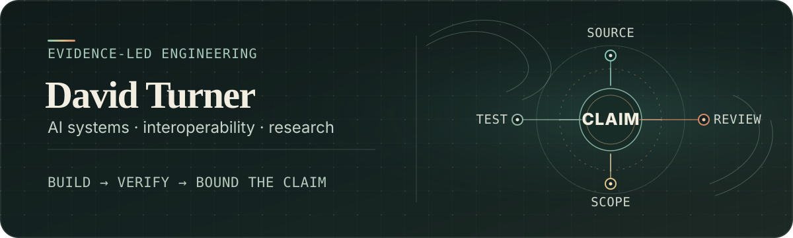
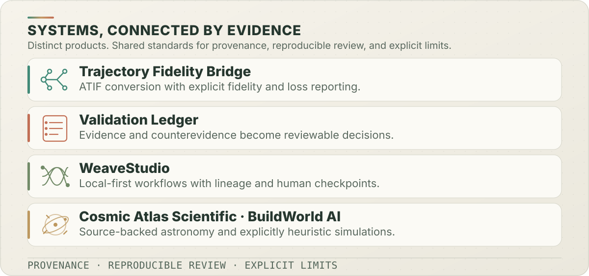
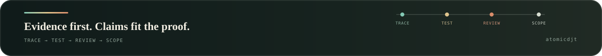

**I build inspectable software, then test whether its claims survive contact with reality.**

AI-assisted engineering · agent interoperability · local-first products · reproducible verification

[**View live projects**](https://ai-project-portfolio-portfolio-hub.vercel.app/) · [**Inspect external engineering proof**](writing/external-validation-upstream-review.md) · [**See what is maintained**](docs/CURRENT_WORK.md) · [**Contact**](mailto:davidelsey9513@gmail.com)

## Start here: three checks of the work

| What to evaluate | Direct evidence | What it actually establishes |
| --- | --- | --- |
| **Can a change withstand adversarial review?** | [Rosetta #320](https://github.com/griddynamics/rosetta/pull/320) · [Engineering case study](writing/engineering-proof-cases.md#case-1-rosetta-320--a-performance-fix-that-required-a-security-equivalence-argument) | A dangerous-command matcher fix merged after independent differential, scaling, and mutation review; not a general security certification |
| **Can an observation be separated from an inference?** | [AgentMeasure DR-005](https://github.com/roy-tong/AgentMeasure/blob/main/design-rationale/DR-005-evidence-calibrated-consumption-claims.md) · [Attributed fixture](https://github.com/roy-tong/AgentMeasure/blob/main/conformance/evidence/inference-boundary-aggregation-replay/README.md) | An external project explicitly credited my limited reviewer input and synthetic fixture; not authorship of the full specification |
| **Can an ambiguous tool result be handled conservatively?** | [CrewAI recovery fixture](https://github.com/atomicdjt/crewai-stripe-recovery-fixture) · [Boundary case study](writing/engineering-proof-cases.md#case-2-recovery-after-an-ambiguous-tool-side-effect) | Local, fault-injected SQLite/provider-double behavior; not a live Stripe, distributed exactly-once, or upstream CrewAI guarantee |

**Verified upstream record:** **9 authored pull requests merged into two external projects** — [7 Rosetta](writing/external-validation-upstream-review.md) and [2 super-productivity](writing/external-validation-upstream-review.md), checked October 20, 2026. See the individual PRs, reviewer findings, limitations, and AI-assistance disclosure in the [full external-validation record](writing/external-validation-upstream-review.md).

## Selected systems

| Project | Why it exists | Inspect it |
| --- | --- | --- |
| **[Trajectory Fidelity Bridge](https://github.com/atomicdjt/trajectory-fidelity-bridge)** | Convert supported Claude Code history to ATIF v1.7 with explicit fidelity/loss reporting, not an invented promise of native session resumption | [PyPI 0.4.1](https://pypi.org/project/atomicdjt-trajectory-fidelity-bridge/) · [Verification report](https://github.com/atomicdjt/trajectory-fidelity-bridge/blob/main/docs/VERIFICATION_REPORT.md) |
| **[Validation Ledger](https://github.com/atomicdjt/validation-ledger)** | Trace evidence and counterevidence into reviewable decisions without passing off a heuristic score as truth | [Live demo](https://validation-ledger.vercel.app/) · [Release validation](https://github.com/atomicdjt/validation-ledger/blob/main/docs/VALIDATION.md) |
| **[WeaveStudio](https://github.com/atomicdjt/weavestudio)** | Build, review, and export local-first workflows with source lineage and human checkpoints | [Live demo](https://weavestudio-nine.vercel.app/) · [Release verification](https://github.com/atomicdjt/weavestudio/blob/main/docs/RELEASE_VERIFICATION.md) |
| **[BuildWorld AI](https://github.com/atomicdjt/buildworld-ai)** | Reproducible graph scenarios for cascades, sensitivity, and systems intuition under explicitly heuristic models | [Live simulation](https://buildworld-ai-v01-improvements.vercel.app/) · [Methodology](https://github.com/atomicdjt/buildworld-ai/blob/main/METHODOLOGY.md) |
| **[Cosmic Atlas Scientific](https://github.com/atomicdjt/cosmic-atlas-scientific)** | An offline astronomy atlas connecting source-derived catalog data, explicit provenance, and bounded numerical tools | [v5.1.0 release](https://github.com/atomicdjt/cosmic-atlas-scientific/releases/latest) · [v6 development reviewer guide](https://github.com/atomicdjt/cosmic-atlas-scientific/blob/main/docs/REVIEWER_QUICKSTART.md) |

## How I work

**Specify an invariant → build the smallest implementation → introduce a falsifying test → inspect independent feedback → publish only the claim the evidence supports.**

My current work includes TypeScript/React applications, Python CLIs, agent-tool boundaries, provenance-aware workflows, and browser/local data models. AI tools assist with research, coding, tests, and drafting; I direct requirements and verification, review changes, and take responsibility for published work.

An upstream merge establishes that a specific contribution was accepted, **not** employment, organizational endorsement, commercial traction, or approval of unrelated work. Local tests do not establish production behavior or independently verified real-world usage.

## Independent review routes

- **Engineering and security reviewers:** start with [Rosetta #320 and the recovery case studies](writing/engineering-proof-cases.md), then inspect tests and the upstream discussion.
- **Technical operations and product teams:** use the [five-minute portfolio review](https://ai-project-portfolio-portfolio-hub.vercel.app/review) and try [Validation Ledger](https://validation-ledger.vercel.app/) or [WeaveStudio](https://weavestudio-nine.vercel.app/).
- **Agent interoperability reviewers:** inspect [Trajectory Fidelity Bridge](https://github.com/atomicdjt/trajectory-fidelity-bridge) and its [compatibility limits](https://github.com/atomicdjt/trajectory-fidelity-bridge/blob/main/docs/COMPATIBILITY.md).
- **Contribution and publication attribution:** use the [current-work index](docs/CURRENT_WORK.md) and [source-by-source correction register](https://github.com/atomicdjt/AI-Project-Portfolio/blob/main/docs/discovery/external-corroboration.md). This distinguishes authored merges from submitted, unverified, rejected, and incorrectly attributed work.

**Technical writing:** [Upstream verification](writing/external-validation-upstream-review.md) · [Tool history and ATIF](writing/from-claude-code-jsonl-to-atif-v1-7.md) · [Verification limits](writing/your-ai-agent-finished-the-task.md) · [Reviewer-friendly PRs](writing/pull-request-descriptions-that-survive-review.md)

[**Portfolio**](https://ai-project-portfolio-portfolio-hub.vercel.app/) · [**Project index**](docs/CURRENT_WORK.md) · [**LinkedIn**](https://www.linkedin.com/in/david-turner-6052491a2/) · [**Email**](mailto:davidelsey9513@gmail.com)

